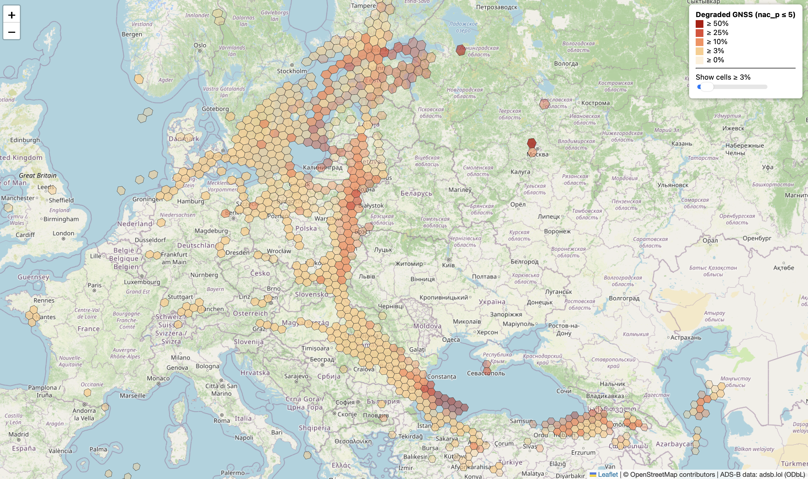

# ADSBDetect

Mapping GNSS interference (jamming/spoofing) from ADS-B position-quality indicators.

Aircraft broadcast how confident they are in their own GNSS position (**NACp**, **NIC**). When many aircraft in the same area report degraded values at the same time, that points to interference. This project turns a day of open ADS-B traces into an H3 hexagon map of where that happens.



**Live demo:** _link here_

## How it works

```
raw adsb.lol traces  ->  extract.py  ->  Parquet  ->  bin_hex.py  ->  GeoJSON  ->  web/ (Leaflet + OpenStreetMap)
```

1. **Extract** (`src/extract.py`): reads the per-aircraft trace files, carries `nac_p`/`nic`/version forward along each track (they are only logged on some points), applies the filters below, keeps at most one point per aircraft per 60 s, and writes Parquet.
2. **Bin** (`src/bin_hex.py`): assigns points to H3 cells (resolution 4, ~22 km edges) with DuckDB, counts **aircraft** rather than points, and exports the daily hex GeoJSON and an hourly Parquet file.
3. **Visualise** (`web/`): a static Leaflet page over OpenStreetMap, coloured by the fraction of degraded aircraft, with opacity scaled by sample size.

## Filters and definitions

| Setting | Value | Reason |
|---|---|---|
| ADS-B version | 2 only | Version 0 does not report NACp properly, and version 1 is much noisier (about 13% of its points report `nac_p` 0, versus under 1% for version 2) |
| Valid `nac_p` | 0 to 11 | Values above 11 do not exist in the spec |
| Aircraft state | airborne only | `nac_p` on the ground is often meaningless |
| Sampling | 1 point / aircraft / 60 s | Stops fast aircraft from dominating |
| Degraded | `nac_p` <= 5 | The data is bimodal: nearly everything is 0 or 8 to 11 |
| Aircraft-hour degraded | at least 50% of its points in that cell-hour are degraded | A single bad sample does not flag an aircraft |
| Minimum sample | `MIN_AC_HOURS_DAILY` aircraft-hours per cell | Hides cells where a few aircraft decide the percentage |

All thresholds are constants at the top of `src/bin_hex.py`.

## Reproduce

```bash
pip install duckdb pyarrow h3 matplotlib
```

1. Download one day from the [adsb.lol globe_history releases](https://github.com/adsblol/globe_history_2026/releases) (use the `prod` release, both archive parts) and extract it:
   ```bash
   mkdir 2026.11.08
   cat v2026.11.08-planes-readsb-prod-0.tar.a* | tar -xf - -C 2026.11.08
   ```
2. Set `DATA_DIR` and `DAY` in `src/config.py`.
3. Run the pipeline:
   ```bash
   python -m src.extract
   python -m src.bin_hex
   ```
4. Copy `hex_daily.geojson` into `web/data/` and serve the page:
   ```bash
   cd web && python -m http.server 8000
   ```
   Then open http://localhost:8000.

Raw data and Parquet files are not in this repository (they are several GB).

## Repository layout

```
src/
  config.py        paths and the day to process
  adsb_io.py       trace reading and field extraction
  extract.py       filtered, downsampled Parquet
  bin_hex.py       H3 binning and GeoJSON export
  check_parquet.py quick DuckDB sanity query
  test.py          nac_p distribution and format checks
web/               static map
```

## Limitations

- **Single day.** One day is not a trend. Multi-day comparison is planned.
- **Uneven coverage.** The data comes from volunteer receivers, so some regions have little or no coverage, and an empty area does not mean no interference.
- **Small samples.** Cells with few aircraft give unstable percentages, which is what the minimum-sample threshold is for.
- **`nac_p` 0 is ambiguous.** It can mean a faulty receiver or lost GNSS under interference. These values are currently included. Planned: a per-aircraft check, so that aircraft reporting 0 everywhere are excluded as faulty, while aircraft reporting 0 only inside a zone count as interference.
- **Jamming vs spoofing** are not yet separated. Spoofing needs position-consistency checks, not just quality indicators.

## Roadmap

- [ ] Per-aircraft separation of faulty receivers from interference
- [ ] Hourly view with a time slider
- [ ] Multi-day data and a date picker
- [ ] Wilson-interval scoring for small samples
- [ ] Spoofing detection (impossible speeds and jumps)

## Data and licence

ADS-B data: [adsb.lol](https://adsb.lol) historical data, licensed under the [ODbL 1.0](https://opendatacommons.org/licenses/odbl/1.0/). Map tiles and data: © OpenStreetMap contributors.

Code licence: _add one (MIT is a common choice)_.
